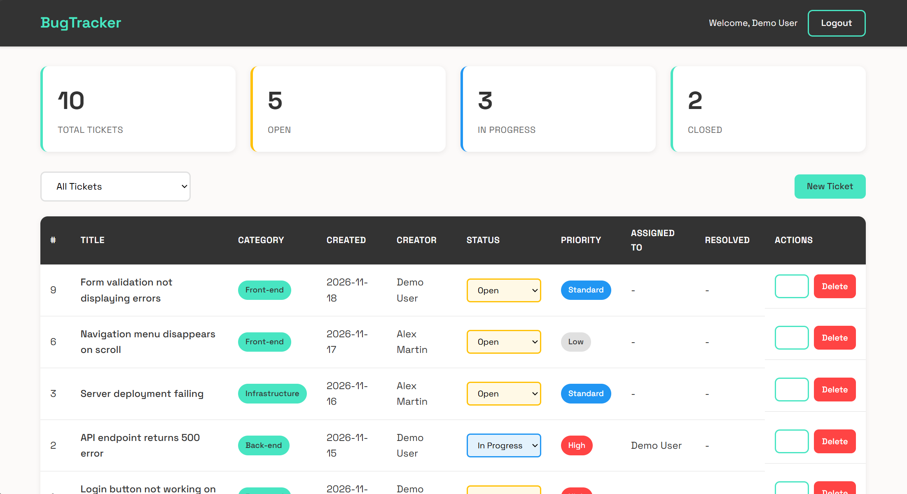
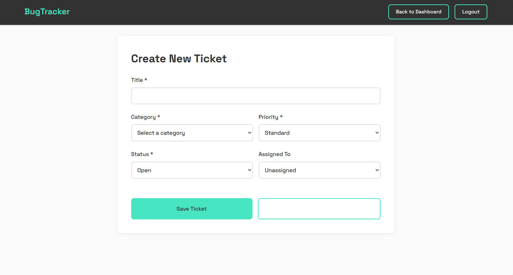
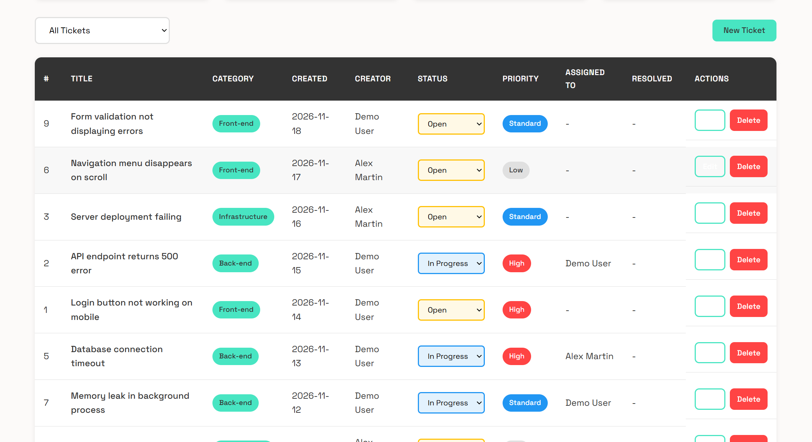
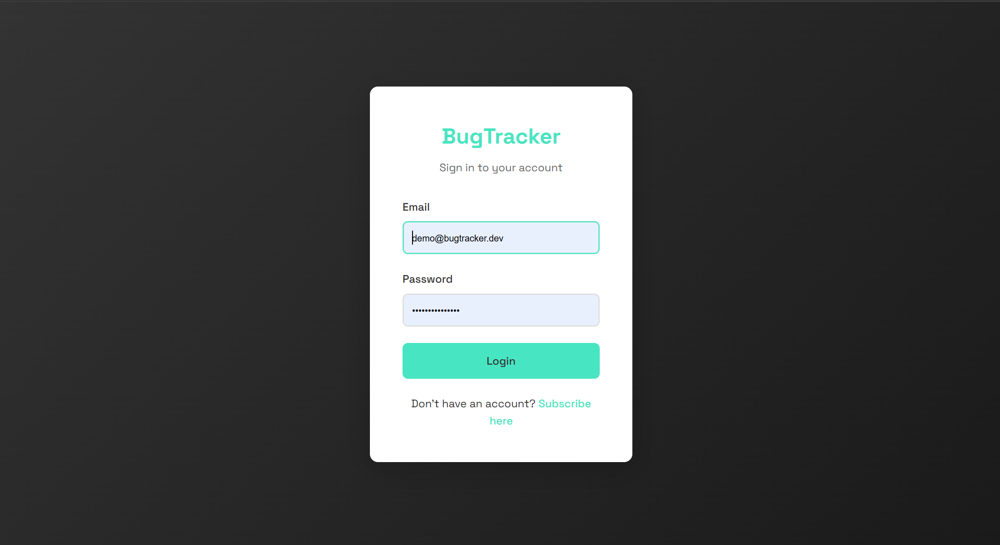

# BugTracker — suivi de tickets de bugs

> Application web de gestion de bugs en **PHP natif et MySQL** : on signale un problème, on le classe, on se l'assigne et on suit son avancement jusqu'à sa résolution.

🔗 **Démo en ligne** : [bugtracker.alwaysdata.net](https://bugtracker.alwaysdata.net)
👤 **Compte de démonstration** : `demo@bugtracker.dev` / `demo-bugtracker` (les données d'exemple sont partagées : n'y mettez rien de personnel)

> L'interface est en anglais ; la documentation est en français.

## Aperçu







<!-- Vidéo de démonstration : en modifiant ce fichier sur github.com, glissez le fichier .mp4 à cet endroit ; GitHub insère lui-même le lien. -->

## Contexte

Les équipes de développement suivent les bugs avec des outils comme Jira, Mantis ou les « issues » de GitHub. J'ai voulu comprendre comment un tel outil fonctionne de l'intérieur, en le construisant sans framework : base de données, authentification, sécurité, API et interface.

## Tester la démo : le parcours utilisateur

Pour essayer l'application, connectez-vous avec le compte de démonstration ci-dessus, puis suivez ce parcours :

1. Connectez-vous (ou créez un compte).
2. Consultez le tableau de bord : des **statistiques** (total, ouverts, en cours, fermés) et la liste des tickets.
3. Créez un ticket : titre, catégorie, priorité, statut, et éventuellement une personne assignée.
4. Changez le statut d'un ticket depuis le tableau : la demande part en arrière-plan vers une **API JSON**, puis la liste se met à jour.
5. Filtrez par catégorie ou ne gardez que vos tickets (« My tickets »), puis supprimez les tickets obsolètes.

## Fonctionnalités

- Inscription et connexion (mots de passe hachés, sessions sécurisées)
- Tableau de bord avec statistiques et filtres (tous, mes tickets, par catégorie)
- Création, modification et suppression de tickets
- Changement de statut en un clic, via une API JSON
- Date de résolution renseignée automatiquement à la fermeture d'un ticket, et conservée si on le referme
- Données de démonstration prêtes à l'emploi

## Stack

PHP 7.4+ (testé avec PHP 8.3) · MySQL / MariaDB (PDO) · HTML, CSS · JavaScript (`fetch`) · Apache

## Architecture

```
Navigateur ──► pages PHP (login, dashboard, form…) ──┐
    │                                                ├──► MySQL
    └─ JavaScript (fetch) ──► api.php (JSON) ────────┘
```

Les pages PHP génèrent le HTML côté serveur. Le JavaScript ne sert qu'à appeler `api.php` pour changer un statut ou supprimer un ticket, avec le jeton CSRF de la session.

## Structure du projet

```
├── index.php            redirige vers le tableau de bord ou la connexion
├── login.php            connexion
├── subscribe.php        inscription
├── logout.php           déconnexion
├── dashboard.php        tableau de bord : statistiques, filtres, liste
├── form.php             création et modification d'un ticket
├── api.php              API JSON : changement de statut, suppression
├── config.php           configuration, sessions, fonctions communes (CSRF, échappement)
├── config.local.example.php   modèle des identifiants de base de données
├── database.sql         schéma + données de démonstration
├── css/style.css
├── js/dashboard.js
└── tests/smoke-test.sh  test de bout en bout
```

## Modèle de données

```
users (id, name, email UNIQUE, password)
categories (id, title UNIQUE)
tickets (id, title, category_id → categories, priority 0-2, status 0-2,
         created_by → users, assigned_to → users NULL, created_at, resolved_at NULL)
```

Priorité : 0 faible, 1 standard, 2 haute. Statut : 0 ouvert, 1 en cours, 2 fermé.
Les clés étrangères ont leurs règles de suppression : `CASCADE` pour la catégorie et le créateur, `SET NULL` pour l'assigné.

## Sécurité

- **Injection SQL** : toutes les requêtes utilisent de vraies requêtes préparées PDO (`ATTR_EMULATE_PREPARES = false`) ; les filtres du tableau de bord passent par une liste blanche
- **XSS** : toute donnée affichée est échappée avec `htmlspecialchars`
- **CSRF** : un jeton aléatoire par session est exigé sur tous les formulaires et sur l'API
- **Mots de passe** : hachés avec `password_hash` / `password_verify`, 8 caractères minimum
- **Sessions** : cookie `HttpOnly`, `SameSite=Lax`, `Secure` en HTTPS, mode strict, et **nouvel identifiant de session à la connexion** (contre la fixation de session)
- **Validation côté serveur** de chaque champ : statut, priorité, catégorie et assigné doivent exister, longueurs maximales
- **API** : `401` sans session, `403` sans jeton CSRF, `404` pour un ticket inconnu, `405` pour une méthode non autorisée, `400` pour des données invalides
- **Secrets hors du dépôt** : les identifiants de base de données vivent dans `config.local.php` (ignoré par Git) ou dans des variables d'environnement
- **Apache** (`.htaccess`) : liste des dossiers désactivée, fichiers `.sql`, `.md` et `config.local.php` inaccessibles, en-têtes de sécurité

## Installation en local

Prérequis : PHP 7.4+ avec les extensions `pdo_mysql` et `mbstring`, et MySQL ou MariaDB (par exemple via XAMPP).

1. Clonez le dépôt, créez la base et importez le schéma avec les données de démonstration :
   ```bash
   git clone https://github.com/emilie-tankou/bugtracker.git
   cd bugtracker
   mysql -u root -p -e "CREATE DATABASE bugtracker CHARACTER SET utf8mb4"
   mysql -u root -p bugtracker < database.sql
   ```
2. (Facultatif) Copiez `config.local.example.php` en `config.local.php` et renseignez vos identifiants. Les valeurs par défaut conviennent à un XAMPP standard (`root`, sans mot de passe).
3. Lancez le serveur et ouvrez <http://localhost:8000> :
   ```bash
   php -S localhost:8000
   ```
4. Connectez-vous avec `demo@bugtracker.dev` / `demo-bugtracker`.

N'importez `database.sql` qu'**une seule fois** dans une base vide.

## Tests

`tests/smoke-test.sh` parcourt l'application comme un utilisateur, avec `curl` : redirections sans connexion, protection CSRF, changement de l'identifiant de session, création et édition d'un ticket, échappement d'une tentative de XSS, tentative d'injection SQL, codes de réponse de l'API, inscription et déconnexion. Il comporte **27 vérifications**.

```bash
php -S localhost:8000        # dans un terminal
bash tests/smoke-test.sh     # dans un autre
```

Le test crée puis supprime un ticket et crée un compte utilisateur : lancez-le sur une base de test.

## Déploiement

La démo est hébergée sur [alwaysdata](https://www.alwaysdata.com) (offre gratuite : PHP, MySQL, HTTPS, SSH).

1. Créer une base MySQL et un utilisateur dans l'administration.
2. Cloner le dépôt dans `~/www` en SSH, puis importer `database.sql` avec la commande `mysql`.
3. Créer `config.local.php` sur le serveur à partir de `config.local.example.php` (hôte `mysql-COMPTE.alwaysdata.net`, nom de la base, utilisateur, mot de passe).
4. Régler le site en type PHP, avec le dossier du projet comme racine.

## Améliorations apportées après la première version

La première version fonctionnait, mais je l'ai durcie et fiabilisée :

- ajout de la **protection CSRF** et du renouvellement de l'identifiant de session à la connexion
- **validation côté serveur** de chaque champ, et codes HTTP corrects pour l'API
- identifiants de base de données sortis du code (`config.local.php`)
- suppression d'un script d'installation qui effaçait la base, et de fichiers vides
- correction du compte de démonstration, des boutons de statut (mauvais chemin du fichier JavaScript) et de la présélection de la priorité à l'édition
- écriture d'un test de bout en bout

## Limites et pistes d'amélioration

- Tous les utilisateurs connectés peuvent modifier ou supprimer **n'importe quel ticket** : il n'y a pas encore de rôles ni de droits par propriétaire
- Pas de limitation du nombre de tentatives de connexion
- La déconnexion se fait par un lien simple, sans jeton CSRF
- Pas de pagination de la liste de tickets
- Pas de gestion des modifications simultanées : la dernière écriture l'emporte

## Ce que ce projet m'a appris

- Concevoir une base relationnelle (clés étrangères, règles de suppression) à partir d'un dossier de conception
- Écrire une application PHP sans framework, en séparant ce qui touche aux données, à la sécurité et à l'affichage
- Appliquer concrètement les protections de base d'une application web : injection SQL, XSS, CSRF, sessions
- Tester une application de bout en bout et corriger les défauts que ces tests révèlent
- Déployer une application PHP et sa base sur un hébergement mutualisé, sans y laisser de secret

## Auteure

Emilie Tankou — [@emilie-tankou](https://github.com/emilie-tankou)